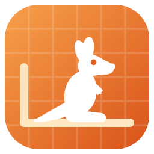
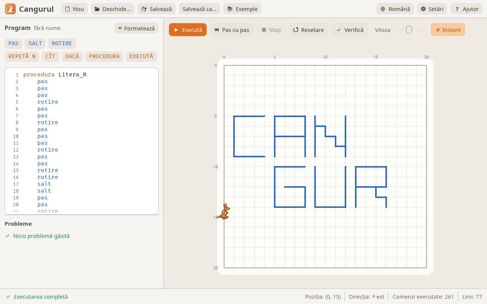
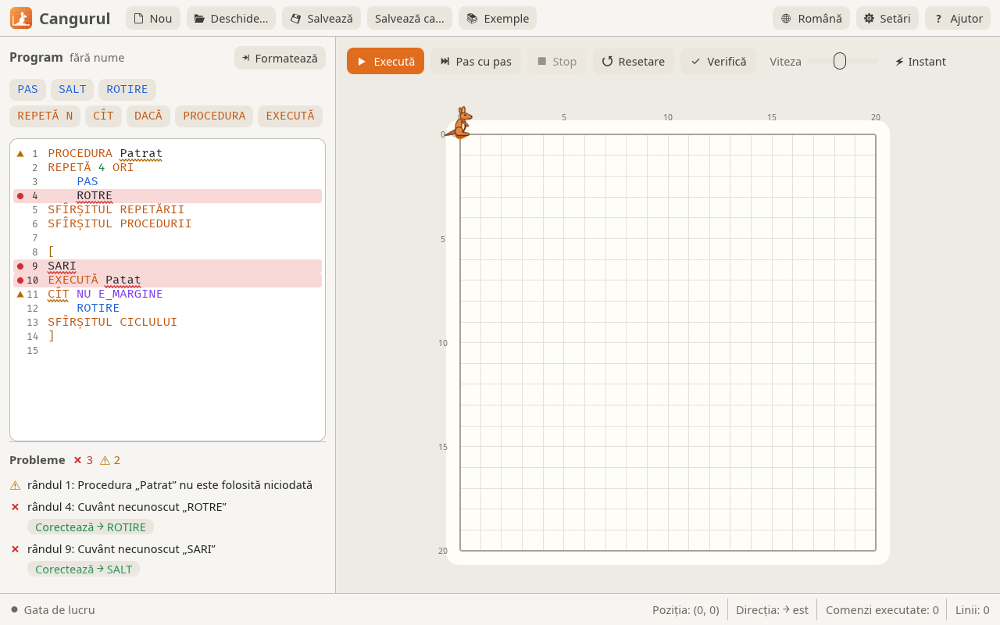

<div align="center">

<p align="center">
  
</p>


**An environment for students learning algorithms — a program written with simple commands makes the kangaroo hop around the field and draw lines.**

[](LICENSE)
[](Cargo.toml)
[](https://github.com/emilk/egui)
[](#windows-7-32-and-64-bit)
[](packaging/linux/)
[](#macos)

[**Quick start**](#quick-start) · [The language](#the-language) · [Code analyzer](#code-analyzer) · [Releases](../../releases) · [Issues](../../issues)

[Română](README.md) · **English** · [Русский](README.ru.md)

</div>

<br />

A **Rust** rewrite of the “Cangurul” program (version 2), used in schools in
Moldova and Romania. `.cng` files from the old version open and run unchanged.
*Cangurul* is Romanian for “the kangaroo”.



## Quick start

Ready-made packages are on the [Releases](../../releases) page:

```
cangurul-<version>-linux-x86_64.AppImage         # Linux, a single file
cangurul-<version>-linux-x86_64.deb              # Ubuntu / Debian / Mint
cangurul-<version>-linux-x86_64.tar.gz           # Linux, archive
cangurul-<version>-macos-universal.dmg           # macOS (Apple Silicon and Intel)
cangurul-<version>-windows-x64.msi               # Windows 10/11, 64-bit, installer
cangurul-<version>-windows-x86.msi               # Windows 10/11, 32-bit, installer
cangurul-<version>-windows-x64-portable.zip      # Windows 10/11, 64-bit
cangurul-<version>-windows-x86-portable.zip      # Windows 10/11, 32-bit
cangurul-<version>-windows7-x86-portable.zip     # Windows 7, 8, 10, 11 (32- and 64-bit)
SHA256SUMS.txt                                   # checksums
```

On each platform:

- **Windows:** the `.msi` installs Cangurul into *Program Files* with a Start
  menu shortcut, and `.cng` files open with a double click (for many
  computers: `msiexec /i cangurul-*.msi /qn`). Without installing: unzip the
  archive and run `Cangurul.exe`;
- **Linux:** make the AppImage executable and run it
  (`chmod +x cangurul-*.AppImage && ./cangurul-*.AppImage`); on Ubuntu / Debian
  you can install the `.deb` (`sudo apt install ./cangurul-*.deb`): Cangurul
  appears in the menu and `.cng` files open with a double click;
- **macOS:** open the `.dmg` and drag `Cangurul.app` onto *Applications*. It is
  not signed with an Apple certificate, so on first launch: right-click →
  *Open* (on macOS 15+: *System Settings → Privacy & Security → Open Anyway*),
  see [macOS](#macos).

### From source

Install [Rust](https://rustup.rs), then in this folder:

```sh
cargo run --release                 # start the application
cargo run --release -- program.cng  # open a file directly
```

The executable ends up in `target/release/` (`cangurul.exe` on Windows) and can
be copied to other computers: it needs no other files. On Windows the kangaroo
icon is embedded in the `.exe` automatically. Rendering uses OpenGL 2.0, so it
also works on older school lab computers.

---

## What's new compared to the original

| | |
|---|---|
| **Interface** | light and dark theme; interface in Romanian, Russian and English |
| **Editor** | line numbers, syntax highlighting, buttons that insert commands (STEP, JUMP, REPEAT, WHILE, IF…) |
| **Running** | smooth animation, the current line highlighted in the editor; step by step, pause, adjustable speed or instant |
| **Analyzer** | the program is checked as you type, with suggested fixes ([details](#code-analyzer)) |
| **The field** | adjustable size; jumps can be shown as dotted lines |
| **Languages** | keywords can be written in Romanian, Russian or English, with or without diacritics |
| **Files** | the program and settings are kept between launches; files open by drag & drop or from the command line |

---

## The language

Keywords can be written in English, Romanian or Russian (see the
[table below](#keywords-in-three-languages)); here they are in English.

| Command | What it does |
|---|---|
| `STEP` | one step forward, leaving a trace |
| `JUMP` | one step forward, without a trace |
| `ROTATE` | turns 90° clockwise |
| `REPEAT N TIMES … END REPEAT` | repeats N times |
| `WHILE [NOT] condition … END CYCLE` | repeats while the condition is true |
| `IF [NOT] condition command1 ELSE command2` | branching (`ELSE` is optional) |
| `PROCEDURE Name … END PROCEDURE` | defines a procedure (before the main program) |
| `EXECUTE Name` | calls the procedure |
| `[ … ]` | the main program |
| `// …` and `* … *` | comments |

Conditions: `IS_BORDER` (the kangaroo faces the edge of the field) and
`IS_LINE` (there is already a line in front of it, or the edge).

The kangaroo starts in the top-left corner, facing right.

### Keywords in three languages

| Română | English | Русский |
|---|---|---|
| `PAS SALT ROTIRE` | `STEP JUMP ROTATE` | `ШАГ ПРЫЖОК ПОВОРОТ` |
| `REPETĂ ORI` | `REPEAT TIMES` | `ПОВТОРИ РАЗ` |
| `CÎT` | `WHILE` | `ПОКА` |
| `DACĂ ATUNCI ALTFEL` | `IF THEN ELSE` | `ЕСЛИ ТОГДА ИНАЧЕ` |
| `NU` | `NOT` | `НЕ` |
| `PROCEDURA EXECUTĂ` | `PROCEDURE EXECUTE` | `ПРОЦЕДУРА ВЫПОЛНИТЬ` |
| `SFÎRȘITUL REPETĂRII / CICLULUI / PROCEDURII` | `END REPEAT / CYCLE / PROCEDURE` | `КОНЕЦ ПОВТОРА / ЦИКЛА / ПРОЦЕДУРЫ` |
| `E_MARGINE E_LINIE` | `IS_BORDER IS_LINE` | `КРАЙ ЛИНИЯ` |

### Keyboard shortcuts

| Key | Action |
|---|---|
| **F5** | run / pause |
| **F6** | step |
| **Esc** | stop |
| **F7** | check |
| **Ctrl+N / Ctrl+O / Ctrl+S** | new / open / save (⌘ on macOS) |

---

## Code analyzer



The program is analyzed on every change (this can be turned off in
*Settings*; then analysis runs with **Check** / F7). The analyzer doesn't stop
at the first mistake, it finds them all:

- wrong words get a wavy underline (red = error, yellow = warning), and the
  line gets a marker next to its number; hovering shows the explanation;
- the **Problems** list under the editor shows all errors and warnings; a
  click takes the cursor to the word;
- for misspelled words a fix is suggested (“Did you mean JUMP?”), applied with
  the **Fix** button — for procedure names too;
- a program with errors doesn't start; warnings don't block running.

| Kind | What is detected |
|---|---|
| **Errors** | unknown words and conditions; `REPEAT` without a number; blocks left open or closed wrongly (`END CYCLE` instead of `END REPEAT`); stray `END`/`ELSE`/`]`; missing command after `IF`; procedures that don't exist or are defined twice; procedures written inside `[ … ]`; text after the main program; unclosed comments |
| **Warnings** | unused procedures; empty blocks; `REPEAT 0 TIMES`; `WHILE` loops that don't move the kangaroo (may run forever); procedures that call themselves without stopping; empty main program |

### Decisions made where the old behavior was undocumented

- the default field is 20 × 20 cells (changeable in *Settings*); all the
  original examples fit in it;
- `IS_LINE` is also true when the edge of the field is in front — otherwise
  the original “Spirala” (spiral) example wouldn't work;
- `IF` and `ELSE` are each followed by a single command (which can be a whole
  `REPEAT` or `WHILE`), as in the old version.

---

## Windows 7 (32 and 64-bit)

A normally built `.exe` requires Windows 10+ (a Rust requirement since version
1.78). For school labs with Windows 7 there is a separate build, made on Linux
with:

```sh
packaging/windows7/package.sh   # result: dist/release/cangurul-<version>-windows7-x86-portable.zip
```

The script installs Rust nightly into `.cache/` and downloads what it needs;
from the system it only needs `curl`, `7z` and the 32-bit MinGW compiler
(`mingw-w64-gcc` on Arch, `gcc-mingw-w64-i686` on Debian/Ubuntu). The archive
(~23 MB) runs on Windows 7, 8, 10 and 11, 32- and 64-bit, without installing
and without extra Windows updates:

- it uses `msvcrt.dll` (present on every Windows 7), not UCRT, which on
  Windows 7 needs update KB2999226;
- the `combase.dll` in the archive (3.5 KB) forwards a function that newer
  Rust libraries look for there, but which on Windows 7 lives in `ole32.dll`;
  on Windows 8+ it is ignored;
- the `soft-gl` folder contains Mesa (software OpenGL). If the graphics card
  has no OpenGL 2.0 driver (“Standard VGA” driver, virtual machines), the
  program restarts itself with Mesa. Slower, but it works. It can be forced
  with `Cangurul.exe --software-gl`;
- this build only lacks screen reader support (that library needs
  Windows 8+). In the code this is the `accessibility` feature, on by default
  in the other builds.

**Note:** this build was checked statically (every function imported from
Windows exists in Windows 7), but has not yet been started on a real Windows 7.

---

## macOS

The disk image `cangurul-<version>-macos-universal.dmg` contains
`Cangurul.app`, a single program for Macs with Apple Silicon (M1…M4) and with
Intel, from macOS 10.13 up. It can only be built on a Mac (for releases, on the
GitHub Actions macOS runner):

```sh
packaging/macos/package.sh   # result: dist/release/cangurul-<version>-macos-universal.dmg
```

The app only has an ad-hoc signature, not one from an Apple Developer
certificate, so Gatekeeper blocks it on first launch. Open it with
right-click → *Open*, or once from Terminal:

```sh
xattr -dr com.apple.quarantine /Applications/Cangurul.app
```

Shortcuts use ⌘ instead of Ctrl. **Note:** this build has not yet been started
on a real Mac.

---

## Code structure

| File | Contents |
|---|---|
| `src/lang.rs` | lexer, error-tolerant parser and compiler |
| `src/check.rs` | semantic analysis: warnings, procedures, suggested fixes |
| `src/vm.rs` | the virtual machine that executes one action at a time |
| `src/world.rs` | the field, the kangaroo, the lines |
| `src/app.rs` | the graphical interface (egui / eframe) |
| `src/i18n.rs` | interface texts in Romanian, Russian and English |
| `src/software_gl.rs` | restarting with software OpenGL (Mesa) on Windows |
| `examples/` | the original examples (converted to UTF-8) |
| `assets/` | the kangaroo sprites, the logo, fonts; the drawings and icons (including `cangurul.icns` for macOS) are generated with `assets/art/make.py`, the banner with `python3 assets/banner.py CANGURUL -o docs/assets/cangurul-banner.png --color "#eb8137"` |
| `packaging/` | AppImage, `.deb` and archive for Linux, `Cangurul.app` (`.dmg`) for macOS, `.msi` and archives for Windows 10/11, the Windows 7 archive |

---

## Releases

The version lives in a single place, `Cargo.toml`, and is changed with
`packaging/version.sh set 3.1.0`. Releases are **automatic**: on a push to
`main` with a version not yet published, GitHub Actions builds the packages
for all platforms and publishes the release. A push with the same version only
runs the tests. Details (in Romanian) in [`docs/releasing.md`](docs/releasing.md).

## Tests

```sh
cargo test
```

The tests check the language, running all the original examples and the
interface: they press the real buttons, without a window. With
`CANGURUL_SHOTS=<folder> cargo test` they also save screenshots (the ones in
`docs/assets/` were made this way).

## License

Cangurul 3 is free software, distributed under the
[GNU General Public License v3](LICENSE) or, at your option, any later version
(`GPL-3.0-or-later`).
