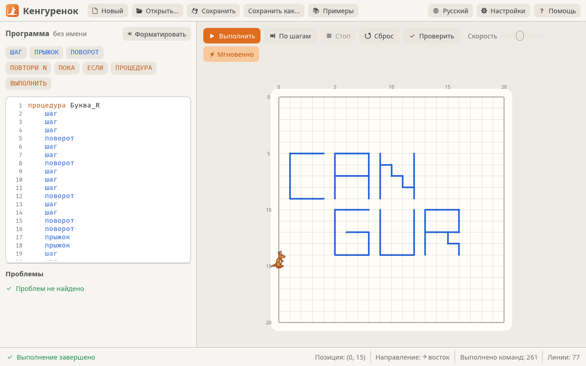
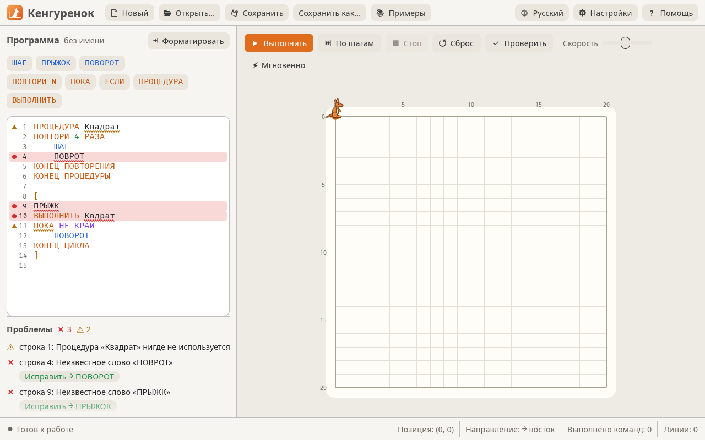

<div align="center">

<p align="center">
  
</p>


**Среда для обучения алгоритмам — программа из простых команд заставляет кенгуру прыгать по полю и рисовать линии.**

[](LICENSE)
[](Cargo.toml)
[](https://github.com/emilk/egui)
[](#windows-7-32-и-64-бита)
[](packaging/linux/)
[](#macos)

[**Сайт**](https://nazdravan.github.io/cangurul/ru/) · [Быстрый старт](#быстрый-старт) · [Язык](#язык) · [Анализатор кода](#анализатор-кода) · [Изменения](CHANGELOG.ru.md) · [Releases](../../releases) · [Issues](../../issues)

[Română](README.md) · [English](README.en.md) · **Русский**

</div>

<br />

Переписан на **Rust** по программе «Cangurul» («Кенгуру», версия 2), которую
используют в школах Молдовы и Румынии. Файлы `.cng` из старой версии
открываются и выполняются без изменений.



## Быстрый старт

Готовые пакеты — на странице [Releases](../../releases):

```
cangurul-<версия>-linux-x86_64.AppImage         # Linux, один файл
cangurul-<версия>-linux-x86_64.deb              # Ubuntu / Debian / Mint
cangurul-<версия>-linux-x86_64.tar.gz           # Linux, архив
cangurul-<версия>-macos-universal.dmg           # macOS (Apple Silicon и Intel)
cangurul-<версия>-windows-x64.msi               # Windows 10/11, 64 бита, установщик
cangurul-<версия>-windows-x86.msi               # Windows 10/11, 32 бита, установщик
cangurul-<версия>-windows-x64-portable.zip      # Windows 10/11, 64 бита
cangurul-<версия>-windows-x86-portable.zip      # Windows 10/11, 32 бита
cangurul-<версия>-windows7-x86-portable.zip     # Windows 7, 8, 10, 11 (32 и 64 бита)
SHA256SUMS.txt                                  # контрольные суммы
```

На каждой платформе:

- **Windows:** `.msi` устанавливает Cangurul в *Program Files* или в другую
  папку, выбранную при установке, с ярлыком в меню «Пуск» и, если отмечено,
  на рабочем столе, а файлы `.cng` открываются двойным щелчком. Новая версия
  устанавливается в ту же папку. Для многих компьютеров:
  `msiexec /i cangurul-*.msi /qn`, с `INSTALLFOLDER="D:\Cangurul"` для другой
  папки и `DESKTOPSHORTCUT=""` без ярлыка на рабочем столе. Без установки: распакуйте zip
  и запустите `Cangurul.exe`;
- **Linux:** сделайте AppImage исполняемым и запустите его
  (`chmod +x cangurul-*.AppImage && ./cangurul-*.AppImage`); в Ubuntu / Debian
  можно установить `.deb` (`sudo apt install ./cangurul-*.deb`): Cangurul
  появится в меню, а файлы `.cng` будут открываться двойным щелчком;
- **macOS:** откройте `.dmg` и перетащите `Cangurul.app` на *Applications*.
  Приложение не подписано сертификатом Apple, поэтому при первом запуске:
  правый щелчок → *Открыть* (в macOS 15+: *Системные настройки →
  Конфиденциальность и безопасность → Всё равно открыть*), см. [macOS](#macos).

### Из исходного кода

Установите [Rust](https://rustup.rs), затем в этой папке:

```sh
cargo run --release                 # запустить приложение
cargo run --release -- program.cng  # сразу открыть файл
```

Исполняемый файл появится в `target/release/` (`cangurul.exe` в Windows); его
можно копировать на другие компьютеры — других файлов ему не нужно. В Windows
значок кенгуру встраивается в `.exe` автоматически. Для вывода используется
OpenGL 2.0, чтобы программа работала и на старых компьютерах школьных классов.

---

## Что нового по сравнению с оригиналом

| | |
|---|---|
| **Интерфейс** | светлая и тёмная тема; интерфейс на румынском, русском и английском |
| **Редактор** | нумерация строк, подсветка синтаксиса, кнопки для вставки команд (ШАГ, ПРЫЖОК, ПОВТОРИ, ПОКА, ЕСЛИ…), подсказки при наборе, автоотступ по Enter, форматирование |
| **Выполнение** | плавная анимация, подсветка текущей строки в редакторе; по шагам, пауза, регулируемая скорость или мгновенно |
| **Анализатор** | программа проверяется во время набора, с предложениями исправлений ([подробнее](#анализатор-кода)) |
| **Поле** | размер настраивается; прыжки можно показывать пунктиром |
| **Языки** | ключевые слова можно писать по-румынски, по-русски или по-английски, с диакритикой или без |
| **Файлы** | программа и настройки сохраняются между запусками; файлы открываются перетаскиванием или из командной строки |

---

## Язык

Ключевые слова можно писать по-русски, по-румынски или по-английски (см.
[таблицу ниже](#ключевые-слова-на-трёх-языках)); здесь они на русском.

| Команда | Что делает |
|---|---|
| `ШАГ` | шаг вперёд, оставляя след |
| `ПРЫЖОК` | шаг вперёд без следа |
| `ПОВОРОТ` | поворот на 90° по часовой стрелке |
| `ПОВТОРИ N РАЗ … КОНЕЦ ПОВТОРА` | повторяет N раз |
| `ПОКА [НЕ] условие … КОНЕЦ ЦИКЛА` | повторяет, пока условие истинно |
| `ЕСЛИ [НЕ] условие команда1 ИНАЧЕ команда2` | ветвление (`ИНАЧЕ` можно опустить) |
| `ПРОЦЕДУРА Имя … КОНЕЦ ПРОЦЕДУРЫ` | определяет процедуру (перед основной программой) |
| `ВЫПОЛНИТЬ Имя` | вызывает процедуру |
| `[ … ]` | основная программа |
| `// …` и `* … *` | комментарии |

Условия: `КРАЙ` (кенгуру стоит лицом к краю поля) и `ЛИНИЯ` (перед ним уже
есть линия или край).

Кенгуру начинает в левом верхнем углу и смотрит вправо.

### Ключевые слова на трёх языках

| Română | English | Русский |
|---|---|---|
| `PAS SALT ROTIRE` | `STEP JUMP ROTATE` | `ШАГ ПРЫЖОК ПОВОРОТ` |
| `REPETĂ ORI` | `REPEAT TIMES` | `ПОВТОРИ РАЗ` |
| `CÎT` | `WHILE` | `ПОКА` |
| `DACĂ ATUNCI ALTFEL` | `IF THEN ELSE` | `ЕСЛИ ТОГДА ИНАЧЕ` |
| `NU` | `NOT` | `НЕ` |
| `PROCEDURA EXECUTĂ` | `PROCEDURE EXECUTE` | `ПРОЦЕДУРА ВЫПОЛНИТЬ` |
| `SFÎRȘITUL REPETĂRII / CICLULUI / PROCEDURII` | `END REPEAT / CYCLE / PROCEDURE` | `КОНЕЦ ПОВТОРА / ЦИКЛА / ПРОЦЕДУРЫ` |
| `E_MARGINE E_LINIE` | `IS_BORDER IS_LINE` | `КРАЙ ЛИНИЯ` |

### Горячие клавиши

| Клавиша | Действие |
|---|---|
| **F5** | выполнить / пауза |
| **F6** | по шагам |
| **Esc** | стоп |
| **F7** | проверить |
| **Ctrl+Shift+F** | форматировать (отступы, ЕСЛИ / ИНАЧЕ на отдельных строках) |
| **Ctrl+N / Ctrl+O / Ctrl+S** | новый / открыть / сохранить (⌘ в macOS) |

---

## Анализатор кода



Программа анализируется при каждом изменении (это можно выключить в
*Настройках*; тогда анализ запускается кнопкой **Проверить** / F7). Анализатор
не останавливается на первой ошибке, а находит все:

- неверные слова подчёркиваются волнистой линией (красной — ошибка, жёлтой —
  предупреждение), а у номера строки появляется отметка; при наведении
  показывается объяснение;
- список **Проблемы** под редактором показывает все ошибки и предупреждения;
  щелчок переводит курсор к нужному слову;
- для слов с опечатками предлагается исправление («Возможно, вы имели в виду
  ПРЫЖОК?»), которое применяется кнопкой **Исправить** — и для имён процедур;
- программа с ошибками не запускается; предупреждения выполнению не мешают.

| Тип | Что обнаруживается |
|---|---|
| **Ошибки** | неизвестные слова и условия; `ПОВТОРИ` без числа; незакрытые или неправильно закрытые блоки (`КОНЕЦ ЦИКЛА` вместо `КОНЕЦ ПОВТОРА`); лишние `КОНЕЦ`/`ИНАЧЕ`/`]`; нет команды после `ЕСЛИ`; несуществующие или дважды определённые процедуры; процедуры внутри `[ … ]`; текст после основной программы; незакрытые комментарии |
| **Предупреждения** | неиспользуемые процедуры; пустые блоки; `ПОВТОРИ 0 РАЗ`; циклы `ПОКА`, которые не двигают кенгуру (могут выполняться бесконечно); процедуры, вызывающие сами себя без остановки; пустая основная программа |

### Решения там, где старое поведение не было документировано

- поле по умолчанию — 20 × 20 клеток (меняется в *Настройках*); все
  оригинальные примеры в него помещаются;
- `ЛИНИЯ` истинно и тогда, когда впереди край поля — иначе оригинальный
  пример «Spirala» (спираль) не работал бы;
- после `ЕСЛИ` и после `ИНАЧЕ` следует по одной команде (это может быть и
  целый `ПОВТОРИ` или `ПОКА`), как в старой версии.

---

## Windows 7 (32 и 64 бита)

Обычно собранный `.exe` требует Windows 10+ (требование Rust начиная с версии
1.78). Для классов с Windows 7 есть отдельная сборка, которая делается в Linux
командой:

```sh
packaging/windows7/package.sh   # результат: dist/release/cangurul-<версия>-windows7-x86-portable.zip
```

Скрипт сам устанавливает Rust nightly в `.cache/` и скачивает всё нужное; из
системы ему нужны только `curl`, `7z` и 32-битный компилятор MinGW
(`mingw-w64-gcc` в Arch, `gcc-mingw-w64-i686` в Debian/Ubuntu). Архив
(~23 МБ) работает в Windows 7, 8, 10 и 11, 32- и 64-битных, без установки и
без дополнительных обновлений Windows:

- используется `msvcrt.dll` (есть в любой Windows 7), а не UCRT, которому в
  Windows 7 нужно обновление KB2999226;
- `combase.dll` из архива (3,5 КБ) перенаправляет функцию, которую новые
  библиотеки Rust ищут там, а в Windows 7 она находится в `ole32.dll`; в
  Windows 8+ он игнорируется;
- папка `soft-gl` содержит Mesa (программный OpenGL). Если у видеокарты нет
  драйвера с OpenGL 2.0 (драйвер «Standard VGA», виртуальные машины),
  программа сама перезапускается с Mesa. Медленнее, но работает. Можно
  включить принудительно: `Cangurul.exe --software-gl`;
- в этой сборке нет только поддержки экранных дикторов (эта библиотека
  требует Windows 8+). В коде это функция `accessibility`, включённая по
  умолчанию в остальных сборках.

**Внимание:** сборка проверена статически (каждая функция, импортируемая из
Windows, есть в Windows 7), но ещё не запускалась на настоящей Windows 7.

---

## macOS

Образ диска `cangurul-<версия>-macos-universal.dmg` содержит `Cangurul.app` —
одну программу для Mac с Apple Silicon (M1…M4) и с Intel, начиная с
macOS 10.13. Собирается только на Mac (для релизов — на macOS-раннере GitHub
Actions):

```sh
packaging/macos/package.sh   # результат: dist/release/cangurul-<версия>-macos-universal.dmg
```

У приложения только ad-hoc подпись, а не сертификат Apple Developer, поэтому
Gatekeeper блокирует его при первом запуске. Откройте его правым щелчком →
*Открыть* или один раз из Терминала:

```sh
xattr -dr com.apple.quarantine /Applications/Cangurul.app
```

Сочетания клавиш используют ⌘ вместо Ctrl. **Внимание:** сборка ещё не
запускалась на настоящем Mac.

---

## Структура кода

| Файл | Содержимое |
|---|---|
| `src/lang.rs` | лексер, устойчивый к ошибкам парсер и компилятор |
| `src/check.rs` | семантический анализ: предупреждения, процедуры, предложения исправлений |
| `src/vm.rs` | виртуальная машина, выполняющая по одному действию за раз |
| `src/world.rs` | поле, кенгуру, линии |
| `src/app.rs` | графический интерфейс (egui / eframe) |
| `src/i18n.rs` | тексты интерфейса на румынском, русском и английском |
| `src/software_gl.rs` | перезапуск с программным OpenGL (Mesa) в Windows |
| `examples/` | оригинальные примеры (переведены в UTF-8) |
| `assets/` | спрайты кенгуру, логотип, шрифты; рисунки и значки (включая `cangurul.icns` для macOS) создаются `assets/art/make.py`, баннер — `python3 assets/banner.py CANGURUL -o docs/assets/cangurul-banner.png --color "#eb8137"` |
| `packaging/` | AppImage, `.deb` и архив для Linux, `Cangurul.app` (`.dmg`) для macOS, `.msi` и архивы для Windows 10/11, архив для Windows 7 |

---

## Релизы

Версия хранится в одном месте — в `Cargo.toml` — и меняется командой
`packaging/version.sh set 3.1.0`. Релизы **автоматические**: при push в `main`
с ещё не опубликованной версией GitHub Actions собирает пакеты для всех
платформ и публикует релиз. Push с той же версией только запускает тесты.
Подробности (на румынском) — в [`docs/releasing.md`](docs/releasing.md).

## Тесты

```sh
cargo test
```

Тесты проверяют язык, выполнение всех оригинальных примеров и интерфейс:
нажимают настоящие кнопки — без окна. С `CANGURUL_SHOTS=<папка> cargo test`
они также сохраняют снимки экрана (снимки в `docs/assets/` сделаны так).

## Лицензия

Cangurul 3 — свободная программа, распространяемая по лицензии
[GNU General Public License v3](LICENSE) или, по вашему выбору, любой более
поздней версии (`GPL-3.0-or-later`).
